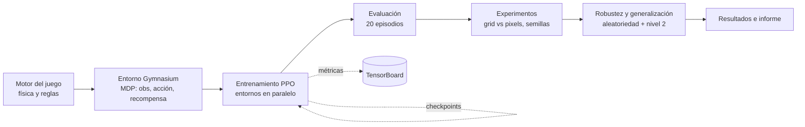
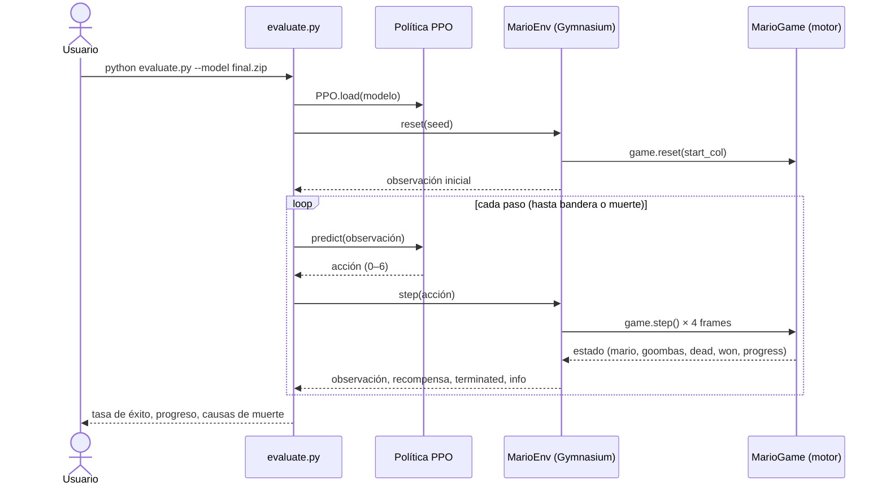

# Mario DRL — Un agente que aprende a jugar por refuerzo

> **Autores:** Persona 1, Persona 2, Persona 3, Persona 4 _(reemplazar por los nombres del equipo)_
> **Curso:** _(curso)_ · **Fecha:** _(fecha de entrega)_


## 1. Introducción

Este proyecto entrena a un agente para que **complete por sí solo un nivel de
plataformas estilo Super Mario Bros**, hecho en Python + Pygame, sin que nadie le
programe reglas de juego. El agente solo recibe una observación del estado, elige
uno de 7 botones y una recompensa le indica si va bien: aprende por **prueba y
error** (aprendizaje por refuerzo profundo, DRL).

El problema es relevante porque es un banco de pruebas clásico y visual del
aprendizaje por refuerzo: un entorno con física, enemigos y fosos, donde el
agente debe aprender a correr, saltar y esquivar sin un mapa explícito. El
proyecto aporta un entorno de juego propio y determinista (motor + entorno
Gymnasium), un contrato de interfaces entre módulos ([INTERFACES.md](INTERFACES.md))
y un pipeline completo de entrenamiento, evaluación y experimentos con PPO.

## 2. Objetivo

**General:** entrenar, por aprendizaje por refuerzo, un agente capaz de completar
el nivel de plataformas desde el inicio.

**Específicos (medibles):**

1. Que el agente llegue a la bandera en **≥ 90 % de 20 episodios** de evaluación,
   también con aleatoriedad activada (acciones pegajosas y velocidad variable de
   goombas).
2. Lograrlo con **menos de 3 horas** de entrenamiento en un portátil.
3. Comprobar que **generaliza**: que supere también un segundo nivel no visto en
   el entrenamiento, por encima de las líneas base aleatoria y heurística.

## 3. Descripción de los datos

No aplica un conjunto de datos clásico: en aprendizaje por refuerzo los «datos»
son la **experiencia** que el agente genera al interactuar con el entorno. Cada
paso produce una tupla (observación, acción, recompensa, siguiente observación)
que PPO usa para aprender. El entorno, las observaciones, las acciones y la
recompensa están definidos en el contrato ([INTERFACES.md](INTERFACES.md) §7):

| Elemento | Definición |
|---|---|
| Observación `grid` | Vector `float32` de 498 valores: rejilla de sólidos y enemigos alrededor de Mario + estado (velocidad, en el suelo, goombas cercanos) |
| Observación `pixels` | Imagen `84×84×1` en grises (apilado de 4 frames) |
| Acciones | 7 discretas (nada, →, →+saltar, →+correr, →+correr+saltar, saltar, ←), cada una mantenida 4 frames |
| Recompensa | Δx/10 por paso, −0.01 por paso, −15 al morir, +50 al tocar la bandera |
| Fin de episodio | Muerte (foso, goomba o tiempo), bandera, o truncado (150 pasos sin avanzar / 3000 pasos) |

Los dos niveles son deterministas; la aleatoriedad (acciones pegajosas, velocidad
de goombas, inicio desde checkpoints) se añade de forma controlada para medir
robustez y evitar que el agente memorice.

## 4. Metodología

Etapas del proyecto, de principio a fin:

1. **Motor del juego** (Persona 1): física, colisiones, enemigos y reglas, con
   límites garantizados (salto ≥ 4 tiles, foso ≤ 3 tiles).
2. **Nivel y gráficos** (Persona 2): diseño de niveles superables, sprites,
   render y modo humano.
3. **Entorno Gymnasium** (Persona 3): traduce el juego a un MDP (observación,
   acción, recompensa) y añade la aleatoriedad para robustez.
4. **Entrenamiento y evaluación** (Persona 4): PPO con varios entornos en
   paralelo, métricas, experimentos e informe.

**Decisiones principales:**

- **Algoritmo PPO** (Stable-Baselines3): robusto, estable y estándar para control
  discreto; `MlpPolicy` para la observación `grid` y `CnnPolicy` para `pixels`.
- **Entornos en paralelo** (`SubprocVecEnv`) y **frame skip de 4** para recoger
  experiencia más rápido.
- **Métricas** específicas del problema: tasa de bandera (`flag_rate`) y progreso
  medio (`progress_mean`), además de la recompensa estándar de PPO.
- **Líneas base** (agente aleatorio y bot heurístico) para situar el resultado.

### Diagrama de flujo metodológico



## 5. Diagrama de interacción (UML)

En inferencia, el agente entrenado juega en un bucle cerrado con el entorno: el
entorno le da una observación, la política (red PPO) elige una acción, el motor
avanza el juego y devuelve la nueva observación y la recompensa, hasta que el
episodio termina (bandera o muerte).



## 6. Resultados

> Las líneas base son medidas reales (30 episodios, nivel 1). Las filas del
> agente PPO se completan tras el entrenamiento de 2 M de pasos
> (`scripts/run_experiments.py`); hasta entonces van marcadas como _pendiente_.
> El detalle y las curvas están en [`docs/informe_final.md`](docs/informe_final.md).

**Líneas base (referencia):**

| Agente | Progreso medio | Tasa de bandera |
|---|---|---|
| Aleatorio | ~20 % | 0/30 (0 %) |
| Heurístico (corre y salta) | ~100 % | 30/30 (100 %) |

**Agente PPO — experimentos (P4.7):**

| Observación | Inicio aleatorio | Tasa de bandera (20 ep.) | Progreso medio |
|---|---|---|---|
| grid | no | _pendiente_ | _pendiente_ |
| grid | sí | _pendiente_ | _pendiente_ |
| pixels (4 frames) | no | _pendiente_ | _pendiente_ |

**Agente PPO — robustez y generalización (P4.8):**

| Condición | Tasa de bandera (20 ep.) | Progreso medio |
|---|---|---|
| Sin aleatoriedad (nivel 1) | _pendiente_ | _pendiente_ |
| Acciones pegajosas (0.1) | _pendiente_ | _pendiente_ |
| Velocidad de goomba 0.3–1.5 | _pendiente_ | _pendiente_ |
| Generalización (nivel 2) | _pendiente_ | _pendiente_ |

**Análisis:** el agente aleatorio apenas avanza (~20 %), así que es un suelo
claro; el bot heurístico pasa el nivel siempre (100 %) y marca el techo. El reto
del agente PPO es acercarse al heurístico **sin reglas programadas** y, sobre
todo, mantener la tasa de bandera con aleatoriedad y en el nivel 2: ahí se ve si
aprendió a jugar o si solo memorizó un nivel determinista.

## 7. Reproducibilidad

### Requisitos e instalación (Python 3.12)

El equipo usa **Python 3.12** (pygame 2.6.1 y PyTorch no tienen soporte fiable en
3.13/3.14); el CI también.

```powershell
py -3.12 -m venv .venv
.\.venv\Scripts\Activate.ps1          # en cmd: .venv\Scripts\activate.bat
pip install -r requirements.txt
```

En Linux/macOS: `python3.12 -m venv .venv && source .venv/bin/activate && pip install -r requirements.txt`.
Comprueba que `(.venv)` aparece en la línea antes de usar `pip`.

### Comandos mínimos

```powershell
# Jugar tú mismo
python play.py                                               # nivel 1 con el teclado
python play.py --level 2                                     # nivel 2

# Comprobar que todo corre
python -m pytest                                             # suite completa (417 tests)
python train.py --cartpole --steps 100000                   # pipeline sano: CartPole llega a ~500 (P4.1)

# Entrenar y evaluar el agente
python train.py --obs grid --steps 2000000 --name lvl1_grid_s0   # entrenamiento principal (P4.6)
python evaluate.py --model models/lvl1_grid_s0/final.zip --episodes 20       # evaluación estadística
python evaluate.py --model models/lvl1_grid_s0/final.zip --render --episodes 3   # verlo jugar
tensorboard --logdir runs                                    # curvas y métricas Mario (P4.2)

# Resultados completos (experimentos + robustez + generalización)
python scripts/run_experiments.py --steps 2000000 --seeds 0 1 2 --random-start   # P4.7, P4.8
python scripts/baselines.py --episodes 30                    # líneas base (P4.5)
python scripts/record_video.py --model models/lvl1_grid_s0/final.zip --episodes 3   # vídeo (P4.9)
```

Los modelos (`models/`), los logs de TensorBoard (`runs/`) y los vídeos no se
versionan (ver `.gitignore`).

<details>
<summary>Más comandos: niveles, validación, perfilado y tests por módulo</summary>

```powershell
python play.py --start-col 94                 # empezar en una columna (probar un tramo)
python play.py --help                         # todas las opciones (--scale, --goomba-speed, --no-hud)
python -m mario_game.level 2                  # el nivel 2 en texto, por tramos
python scripts/export_captures.py             # capturas PNG de sprites y niveles
python -m mario_game.validate --level 2 --goomba-speeds 0.3 0.5 1.0 1.5   # ¿es superable el nivel?
python scripts/profile_training.py --obs grid # pasos/s por hilos y entornos (P4.4)
python -m pytest -v tests/test_contract.py    # solo los límites del contrato
python -m pytest -v tests/test_training.py    # utilidades y callback de entrenamiento (P4)
python scripts/benchmark_engine.py            # frames/s del motor sin gráficos
```

Teclas del modo humano: flechas / A·D moverse, espacio·↑·W saltar (mantener =
salto más alto), shift·X correr, P pausa, R reiniciar, 1-9/0 reiniciar desde el
checkpoint n / el inicio, Esc·Q salir.

</details>

### Estructura del repositorio

| Ruta | Contenido | Responsable |
|---|---|---|
| `mario_game/constants.py` | Constantes compartidas | Persona 1 |
| `mario_game/game.py` | Motor: física, colisiones, goombas, reglas | Persona 1 |
| `mario_game/level.py` | Clase `Level`, `build_level_1()` y `build_level_2()` | Persona 2 |
| `mario_game/sprites.py`, `mario_game/render.py` | Sprites y dibujo del juego | Persona 2 |
| `mario_game/validate.py` | Bot e informe de validación de niveles | Persona 2 |
| `play.py` | Modo humano con teclado | Persona 2 |
| `mario_env.py` | Entorno Gymnasium (MDP) | Persona 3 |
| `mario_stub.py` | Stub del juego para probar el entorno | Persona 3 |
| `train.py`, `evaluate.py`, `mario_training.py` | Entrenamiento, evaluación y utilidades | Persona 4 |
| `scripts/baselines.py`, `profile_training.py`, `run_experiments.py`, `record_video.py` | Líneas base, perfilado, experimentos y vídeo | Persona 4 |
| `tests/` | Tests del motor, niveles, render, entorno y entrenamiento | Todas |
| `docs/` | Capturas, informes de validación e [informe final](docs/informe_final.md) | Personas 2 y 4 |
| `.github/workflows/tests.yml` | CI: tests y benchmark en cada push y PR | Persona 1 |

### Uso mínimo del motor

```python
from mario_game.game import MarioGame
from mario_game.level import build_level_1

game = MarioGame(build_level_1())    # un Level por juego: el motor modifica los bloques ?
game.reset()                         # o reset(start_col=c) desde un checkpoint
while not (game.dead or game.won):
    game.step(left=False, right=True, jump=False, run=True)   # 1 frame
print(game.progress, game.death_reason)
```

El contrato entre módulos está en [INTERFACES.md](INTERFACES.md). El CI de GitHub
ejecuta los tests y el benchmark en cada `push` y PR, con Python 3.12.
