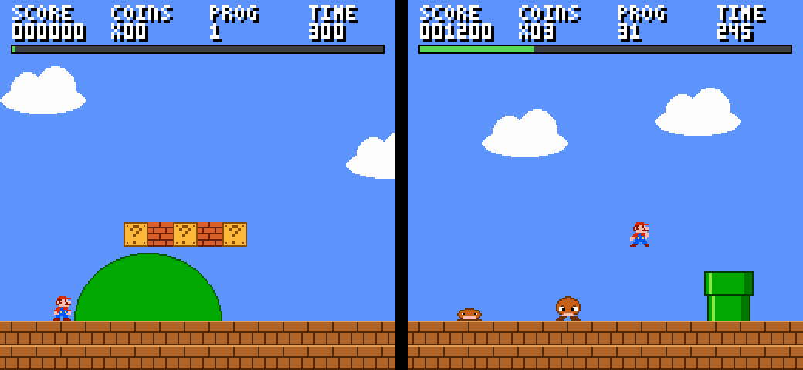
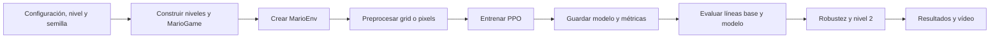
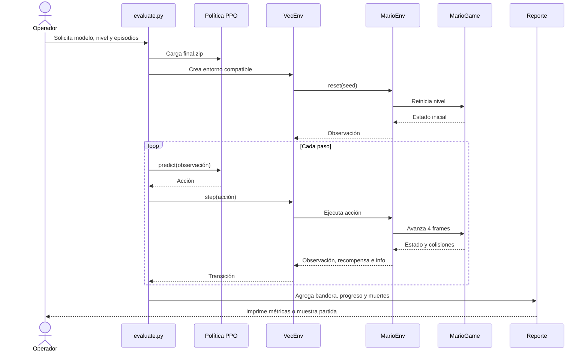

# Mario DRL

> **Autores:** Daniel Giraldo, Diego Angarita, Esteban Alvarez e Ismael Garcia<br>
> **Curso:** Introducción a la inteligencia artificial<br>
> **Fecha:** 13 de noviembre de 2026



## 1. Introducción

Mario DRL implementa un juego de plataformas 2D inspirado en *Super Mario
Bros.* con Python y Pygame, y lo formula como un entorno de aprendizaje por
refuerzo compatible con Gymnasium. Un agente PPO, implementado con
Stable-Baselines3, aprende a avanzar, saltar y esquivar enemigos hasta llegar a
la bandera mediante prueba y error.

El proyecto integra motor, niveles, observaciones, recompensas, entrenamiento,
evaluación y visualización. Su aporte es comparar una representación estructurada
del estado (`grid`) con una representación visual (`pixels`) y medir el agente
frente a líneas base, perturbaciones controladas y un nivel no visto.

## 2. Objetivo

**Objetivo general:** entrenar y evaluar un agente PPO capaz de completar el
nivel 1 de Mario desde el inicio.

**Objetivos específicos:**

- Alcanzar la bandera en al menos el 90 % de 20 episodios del nivel 1.
- Comparar tasa de bandera, progreso y recompensa contra un agente aleatorio y
  un bot heurístico en 30 episodios.
- Medir la robustez ante acciones pegajosas y velocidades variables de goomba,
  y la generalización al nivel 2 en 20 episodios por condición.

## 3. Descripción de los datos

No se utiliza un conjunto de datos externo. Los datos se generan durante la
interacción entre el agente y `MarioEnv`: cada paso produce una observación, una
acción, una recompensa y la siguiente observación. Los niveles se construyen de
forma procedural en `mario_game/level.py` a partir de mapas ASCII y tiles.

| Elemento | Fuente y formato | Tamaño o variables principales |
|---|---|---|
| Niveles | `build_level_1()` y `build_level_2()` | 200 columnas, 15 filas y 3200 px de ancho |
| `grid` | Vector `float32` normalizado | 498 valores con sólidos, enemigos y estado de Mario |
| `pixels` | Imagen `uint8` en escala de grises | `84 × 84 × 1`; puede apilar 4 frames |
| Acciones | Espacio discreto de Gymnasium | 7 acciones mantenidas durante 4 frames |
| `info` del episodio | Diccionario de Gymnasium | progreso, bandera, pasos, nivel, muerte y causa |

El preprocesamiento de `pixels` convierte la vista a `84 × 84` en escala de
grises, transpone los canales para la CNN y apila frames cuando se usa
`--frame-stack 4`. Para `grid`, el entorno codifica tiles, enemigos y estado
físico en un vector normalizado. La semilla controla la aleatoriedad.

La recompensa combina avance horizontal (`Δx / 10`) y coste temporal (`−0,01`),
con `−15` al morir y `+50` al tocar la bandera. Un episodio termina al morir o
llegar a la bandera, y se trunca tras 150 pasos sin progreso o 3000 pasos.

**Limitaciones y restricciones:** los niveles son pequeños y diseñados
manualmente; el nivel 2 conserva las mismas piezas y físicas; los resultados
dependen de la semilla y la configuración; y la recompensa no equivale a la
puntuación clásica. No hay un archivo `LICENSE` en el repositorio, por lo que el
código y los resultados deben reutilizarse o redistribuirse solo con autorización
de los autores o del curso.

## 4. Metodología

### Etapas

1. **Preparación:** se construyen los niveles y se ejecuta `MarioGame` dentro
   del entorno registrado como `MarioPygame-v0`.
2. **Modelado:** `MarioEnv` traduce las siete acciones, mantiene cada decisión
   durante cuatro frames y genera observaciones `grid` o `pixels`.
3. **Entrenamiento:** PPO usa `MlpPolicy` para `grid` y `CnnPolicy` para
   `pixels`, con entornos vectorizados, checkpoints y TensorBoard.
4. **Evaluación:** se calculan tasa de bandera, progreso medio, recompensa,
   pasos y causas de muerte frente a las líneas base y las perturbaciones.
5. **Despliegue local:** `evaluate.py` carga el modelo guardado y ejecuta la
   inferencia sobre el motor. No se usa servidor, base de datos ni servicio
   externo; `play.py` y `record_video.py` permiten visualizar la ejecución.

### Decisiones principales

- **PPO:** trabaja con acciones discretas y tiene soporte para entornos
  vectorizados en Stable-Baselines3.
- **Observaciones:** `grid` ofrece un estado compacto; `pixels` permite evaluar
  el aprendizaje directamente desde la imagen.
- **Configuración:** 2 000 000 pasos, `n_steps=512`, `batch_size=256`,
  `learning_rate=2,5×10⁻⁴`, `ent_coef=0,01`, 16 entornos y un hilo de PyTorch
  en la corrida de referencia. El código usa 8 entornos por defecto.
- **Métricas:** tasa de bandera para el éxito final, progreso medio para medir
  avance, recompensa media para el objetivo de PPO y causa de muerte para
  analizar fallos.
- **Líneas base:** el agente aleatorio fija un mínimo y el heurístico confirma
  que el nivel es superable sin aprendizaje.

### Diagrama de flujo metodológico



## 5. Diagrama de interacción (UML)

El modelo se ejecuta localmente después del entrenamiento. El operador indica el
modelo, nivel y número de episodios; `evaluate.py` carga la política, consulta al
entorno y devuelve las métricas. `MarioGame` actúa como simulador y no requiere
base de datos.



## 6. Resultados

### Validación de los niveles

El bot heurístico valida la superabilidad del motor desde los checkpoints. Esta
prueba no representa aprendizaje PPO.

| Evaluación | Resultado |
|---|---:|
| Nivel 1 con bot heurístico | 36/36 partidas ganadas |
| Nivel 2 con bot heurístico | 44/44 partidas ganadas |

### Comparación y robustez del modelo

Los valores corresponden a la corrida reportada de `lvl1_grid_s0`, medida el 8
de noviembre de 2026. La evaluación usa las métricas definidas arriba y 20
episodios por condición; las líneas base usan 30 episodios.

| Agente o condición | Episodios | Progreso medio | Tasa de bandera |
|---|---:|---:|---:|
| Aleatorio, nivel 1 | 30 | ~20 % | 0/30 (0 %) |
| Heurístico, nivel 1 | 30 | ~100 % | 30/30 (100 %) |
| PPO, nivel 1 sin aleatoriedad | 20 | 100 % | 20/20 (100 %) |
| PPO, acciones pegajosas `0,1` | 20 | 100 % | 20/20 (100 %) |
| PPO, goomba `0,3–1,5` px/frame | 20 | 96,9 % | 19/20 (95 %) |
| PPO, pegajosas + velocidad variable | 20 | 89,3 % | 17/20 (85 %) |
| PPO, nivel 2 no visto | 20 | 88,8 % | 16/20 (80 %) |

El PPO supera ampliamente al agente aleatorio y cumple el umbral del 90 % en
el nivel 1 sin aleatoriedad y con cada perturbación individual reportada. No lo
cumple cuando se combinan perturbaciones ni al generalizar al nivel 2. La
heurística alcanza el 100 % porque contiene reglas programadas y funciona como
referencia superior, no como modelo aprendido.

La comparación completa entre `grid` y `pixels`, con tres semillas y con o sin
inicio aleatorio, se genera mediante `scripts/run_experiments.py` en
`docs/resultados.md`. Las cifras anteriores son una corrida concreta y pueden
variar con otra semilla o configuración.

## 7. Reproducibilidad

### Instalación

Se recomienda Python 3.12 y las versiones de `requirements.txt`.

```powershell
py -3.12 -m venv .venv
.\.venv\Scripts\Activate.ps1
pip install -r requirements.txt
```

En Linux/macOS:

```bash
python3.12 -m venv .venv
source .venv/bin/activate
pip install -r requirements.txt
```

### Comandos mínimos

```powershell
# Validar los dos niveles
python -m mario_game.validate --level 1 --goomba-speeds 0.3 0.5 1.0 1.5 --report docs/validacion_nivel1.md
python -m mario_game.validate --level 2 --goomba-speeds 0.3 0.5 1.0 1.5 --report docs/validacion_nivel2.md

# Probar el pipeline
python train.py --cartpole --steps 100000

# Entrenar y evaluar PPO
python train.py --obs grid --steps 2000000 --name lvl1_grid_s0 --seed 0 --n-envs 16 --torch-threads 1
python evaluate.py --model models/lvl1_grid_s0/final.zip --obs grid --episodes 20 --seed 0

# Evaluar robustez y generalización
python evaluate.py --model models/lvl1_grid_s0/final.zip --obs grid --episodes 20 --sticky-prob 0.1 --goomba-speed-min 0.3 --goomba-speed-max 1.5 --seed 0
python evaluate.py --model models/lvl1_grid_s0/final.zip --obs grid --episodes 20 --level 2 --seed 0

# Pruebas y métricas
python -m pytest -v
tensorboard --logdir runs
```

Para comparar `grid` y `pixels` sin lanzar entrenamientos se puede usar:

```powershell
python scripts/run_experiments.py --dry-run
```

Para jugar manualmente:

```powershell
python play.py
python play.py --level 2
```

### Estructura del repositorio

| Ruta | Función |
|---|---|
| `mario_game/` | Motor, niveles, sprites, render y validación |
| `mario_env.py` | Entorno Gymnasium, observaciones, acciones y recompensas |
| `mario_training.py` | Entornos vectorizados y callback de métricas |
| `train.py` | Entrenamiento PPO, checkpoints y TensorBoard |
| `evaluate.py` | Evaluación estadística o visual |
| `scripts/` | Líneas base, perfilado, experimentos, benchmarks y vídeo |
| `tests/` | Pruebas del motor, niveles, render, entorno y entrenamiento |
| `docs/` | Informe, validaciones y capturas |
| `requirements.txt` | Dependencias del proyecto |
| `.github/workflows/tests.yml` | Pruebas y benchmarks en integración continua |

El contrato entre módulos está en [`INTERFACES.md`](INTERFACES.md). Los modelos,
logs y archivos `.zip` generados se ignoran mediante `.gitignore`.
